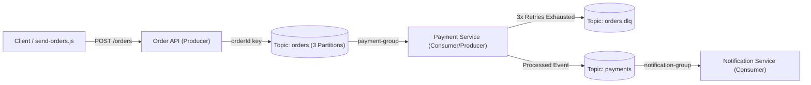

# Real-Time Order Event Processing Platform

A resilient event-driven microservices pipeline demonstrating core Apache Kafka concepts using Node.js and KRaft mode.

---

## Architecture



---

## Tech Stack

- **Runtime & Frameworks:** Node.js, Express
- **Kafka Client:** KafkaJS
- **Message Broker:** Apache Kafka (KRaft mode, single broker)
- **Infrastructure & Monitoring:** Docker Compose, Kafka UI

---

## Kafka Concepts Demonstrated

- **Partitions & Keys:** Hash-based partitioning via `orderId` to preserve per-entity ordering across distributed logs.
- **Consumer Groups:** Work distribution across parallel consumer instances with load balancing.
- **Independent Consumer Groups:** Decoupled fan-out where each service (`payment-group`, `notification-group`) reads the full event stream independently.
- **Manual Offset Commits:** Committing offsets only after successful downstream side-effects to guarantee at-least-once delivery.
- **Retries & Exponential Backoff:** Handling transient failures with progressive backoff delays (1s, 2s, 4s).
- **Dead Letter Queue (DLQ):** Isolating unprocessable poison pill messages to `orders.dlq` without stalling consumer partition offsets.
- **Idempotent Producer:** Preventing duplicate record writes on network-level retries via `idempotent: true`.
- **Consumer Deduplication:** In-memory caching of processed message IDs to handle duplicate at-least-once deliveries.
- **Group Rebalancing:** Dynamic partition reallocation across active consumers during scaling and failovers.

---

## Getting Started

### 1. Prerequisites & Infrastructure Setup

Start the Kafka broker and Kafka UI:

```bash
docker compose up -d
```

- **Kafka Broker:** `localhost:9092`
- **Kafka UI:** [http://localhost:8085](http://localhost:8085)

### 2. Install Dependencies

```bash
npm install
```

### 3. Run the Services

Open separate terminal windows for each service:

- **Terminal 1 — Order API (Producer):**
  ```bash
  node index.js
  ```
- **Terminal 2 — Payment Service (Consumer/Producer):**
  ```bash
  node payment.js
  ```
- **Terminal 3 — Notification Service (Consumer):**
  ```bash
  node notification.js
  ```

---

## Demo Walkthrough

1. **Send Orders with Duplicate Test:**
   ```bash
   node send-orders.js
   ```
   Publishes 50 order events plus 3 intentional duplicates of the same order ID.

2. **Inspect Messages in Kafka UI:**
   Open [http://localhost:8085](http://localhost:8085) to view:
   - Partitions and offsets for `orders` and `payments`
   - Messages routed to `orders.dlq` when simulated retries fail
   - Consumer group lag and member assignments

3. **Demonstrate Consumer Rebalancing:**
   - Launch a second Payment instance in another terminal:
     ```bash
     node payment.js
     ```
   - Watch the logs: Kafka rebalances the 3 partitions across both instances.
   - Terminate (`Ctrl+C`) one instance: Kafka automatically assigns all 3 partitions back to the surviving instance.

---

## What I Learned

- Event-driven microservices decouple dependencies using append-only immutable logs.
- Kafka keys determine partition routing, guaranteeing order per entity while scaling horizontally.
- Manual offset commits are crucial for avoiding data loss in at-least-once pipelines.
- DLQ patterns prevent poison pill events from halting consumer partition progression.
- Idempotency must be addressed on both producer (broker-level) and consumer (application-level) tiers.

---

## Next Improvements

- **PostgreSQL:** Persist order states and payment transactions with the transactional outbox pattern.
- **Redis Deduplication:** Replace in-memory deduplication with distributed Redis TTL keys.
- **Metrics & Observability:** Export consumer lag metrics to Prometheus and visualize them on Grafana.
- **Real-Time Dashboard:** Build a WebSocket front-end to visualize order flows live.

